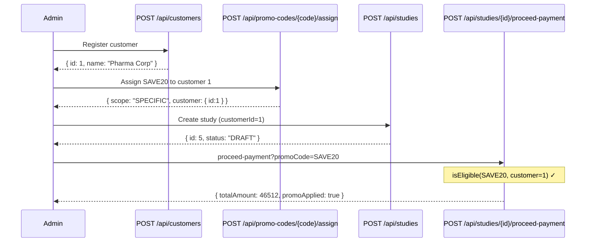

# Study Status — State Transition Diagram

```mermaid
stateDiagram-v2
    direction LR

    [*] --> DRAFT : POST /api/studies?customerId=\nUser saves the New Study Creation Form.\nVisit rows auto-generated. Study linked to customer (optional).

    DRAFT --> DRAFT : PUT /api/studies/{id}/visits\nUser fills in visit details.\n(visitNumber is locked)

    DRAFT --> ACTIVE : POST /api/studies/{id}/proceed-payment?promoCode=FREESTUDY\n── FULL discount promo ──\ntotalAmount = ₹0 → payment gateway SKIPPED\nStudy activates immediately.

    DRAFT --> ACTIVE : POST /api/studies/{id}/proceed-payment\n── Normal / PERCENTAGE / FLAT promo ──\nFee calculated + 18% GST (discount applied).\nUPI gateway called → success → ACTIVE.

    DRAFT --> PAYMENT_PENDING : POST /api/studies/{id}/proceed-payment\n── Async mode (production) ──\nGateway initiated; waiting for webhook.

    PAYMENT_PENDING --> ACTIVE : POST /api/studies/{id}/payment-callback\n{ "success": true, "paymentReference": "UPI_TXN_…" }\nGateway confirms → study ACTIVE.

    PAYMENT_PENDING --> PAYMENT_PENDING : POST /api/studies/{id}/payment-callback\n{ "success": false }\nPayment failed — invoice.status = FAILED.\nUser can retry (status stays PAYMENT_PENDING).

    ACTIVE --> [*] : Study appears in My Studies table\nGET /api/studies/my-studies
```



## Status Meanings

| Status            | Description                                                                    |
|-------------------|--------------------------------------------------------------------------------|
| `DRAFT`           | Study created; visit details not yet filled or payment not initiated.          |
| `PAYMENT_PENDING` | Payment gateway has been called but the webhook has not yet confirmed.         |
| `ACTIVE`          | Payment confirmed (or fully waived by promo). Visible on My Studies dashboard. |

## Invoice Status

| Status      | When set                                                               |
|-------------|------------------------------------------------------------------------|
| `INITIATED` | Invoice created by `FeeCalculatorDomainService.buildInvoice()`         |
| `SUCCESS`   | Payment confirmed by gateway webhook OR promo waiver (total = ₹0)     |
| `FAILED`    | Gateway webhook reports failure; study stays `PAYMENT_PENDING` to retry|

---

## Razorpay vs UPI Payment Routing

```
POST /api/studies/{id}/proceed-payment
  │
  ├─ totalAmount = ₹0 (FULL promo)
  │    └─ paymentRef = "PROMO_WAIVED_XXX"
  │       invoice = SUCCESS, study = ACTIVE  (both gateways)
  │
  ├─ gateway.isAsynchronous() = true  (spring.profiles.active=razorpay)
  │    └─ Razorpay SDK: create order → orderId = "order_XXXX"
  │       invoice = INITIATED, study = PAYMENT_PENDING
  │       response includes: razorpayOrderId, razorpayKeyId, requiresCheckout=true
  │
  │       Frontend renders Razorpay checkout
  │         → user pays
  │         → POST /api/razorpay/callback { orderId, paymentId, signature }
  │              verifyPaymentSignature() ✓
  │              confirmPayment() → invoice = SUCCESS, study = ACTIVE
  │
  │       Alternatively, Razorpay server sends:
  │         → POST /api/razorpay/webhook { event: "payment.captured" }
  │              verifyWebhookSignature(body, X-Razorpay-Signature) ✓
  │              confirmPayment() → invoice = SUCCESS, study = ACTIVE
  │
  └─ gateway.isAsynchronous() = false  (default / UPI demo profile)
       └─ UPI mock: paymentRef = "UPI_TXN_XXXX"
          invoice = SUCCESS, study = ACTIVE  (immediate)
```

---

## Promo Code Routing (with Provisioning Check)

```
promoCode present?
  │
  ├─ NO  ──────────────────────────→ UPI gateway → paymentRef = "UPI_TXN_…"
  │
  └─ YES → validate(code)
             │
             ├─ not found   → 400 Bad Request
             ├─ expired     → 409 Conflict
             ├─ inactive    → 409 Conflict
             ├─ maxed-out   → 409 Conflict
             │
             └─ VALID → checkPromoEligibility(promoCode, study.customer)
                          │
                          ├─ study has no customer → bypass (backwards compat)
                          │
                          ├─ assignment found (specific or global) → proceed
                          │
                          └─ no assignment → 409 "Promo not provisioned for this customer"
                                              │
                                              (admin must POST /api/promo-codes/{code}/assign first)

             └─ ELIGIBLE → buildInvoice(study, promo)
                             │
                             ├─ totalAmount == 0 (FULL)  → paymentRef = "PROMO_WAIVED_XXX"
                             │                              skip gateway, activate immediately
                             │                              write PromoCodeUsageLog entry
                             │
                             └─ totalAmount  > 0  ──────→ UPI gateway → paymentRef = "UPI_TXN_…"
                                                           write PromoCodeUsageLog entry
```

---

## Promo Code Provisioning Flow



---

## Promo Code Assignment Scope

| Scenario                        | Assignment record                       | Eligible customers         |
|---------------------------------|-----------------------------------------|----------------------------|
| Global grant                    | `promo_code_id=X, customer_id=NULL`     | Every customer             |
| Specific grant                  | `promo_code_id=X, customer_id=1`        | Customer 1 only            |
| Both global + specific          | Two rows for same promo                 | Everyone (global wins)     |
| No assignment                   | No row                                  | Nobody (payment blocked)   |
| Study with no customer linked   | n/a                                     | Bypass check (legacy mode) |

---

## PromoCodeUsageLog — Written on Every Redemption

| Field              | Value                                        |
|--------------------|----------------------------------------------|
| `promoCode`        | Code string, e.g. `SAVE20`                   |
| `customerId`       | FK to customer (nullable for legacy studies) |
| `customerName`     | Snapshot of name at redemption time          |
| `studyBusinessId`  | e.g. `STUDY-2026-C1`                         |
| `studyDbId`        | Internal DB id of the study                  |
| `discountAmount`   | Actual ₹ discount applied                    |
| `usedAt`           | Timestamp of redemption                      |
